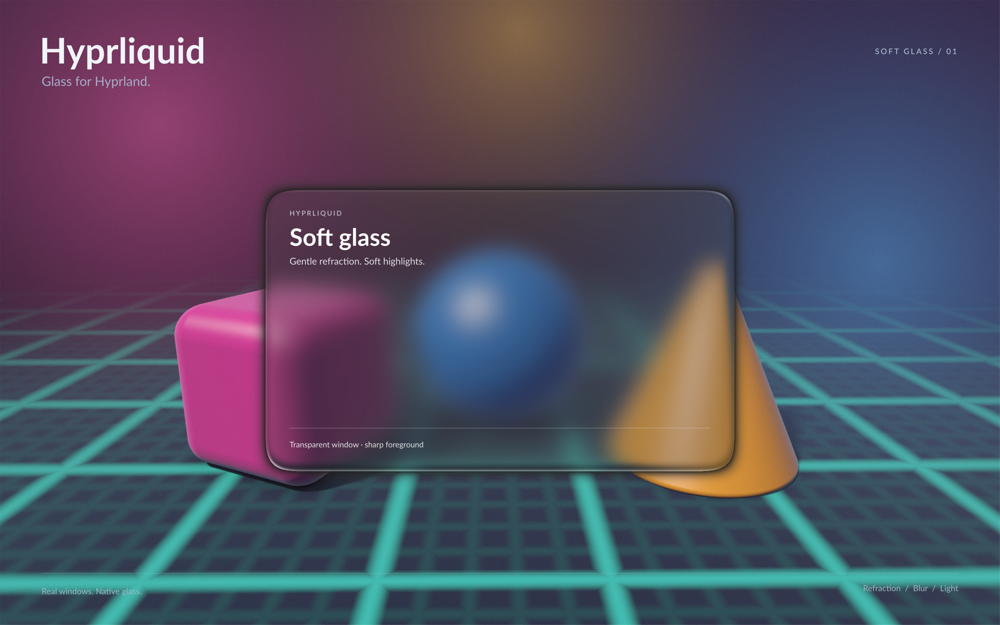
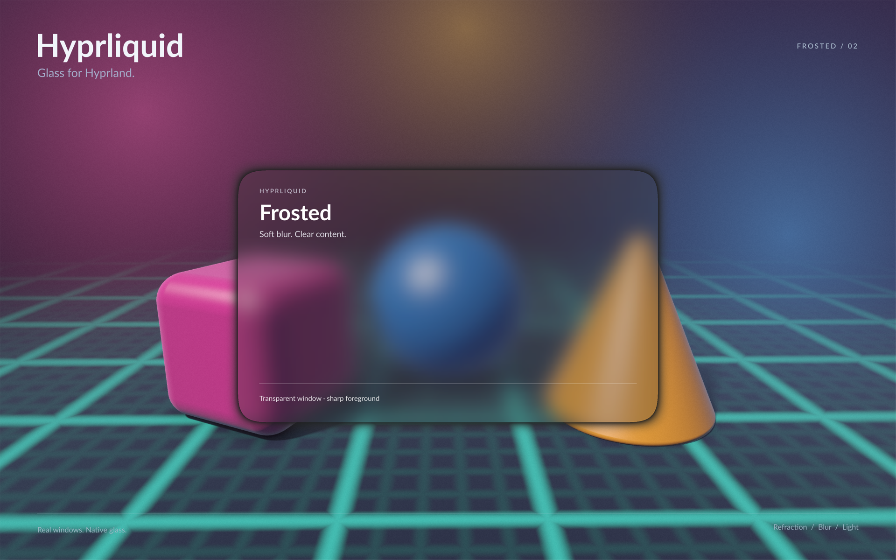
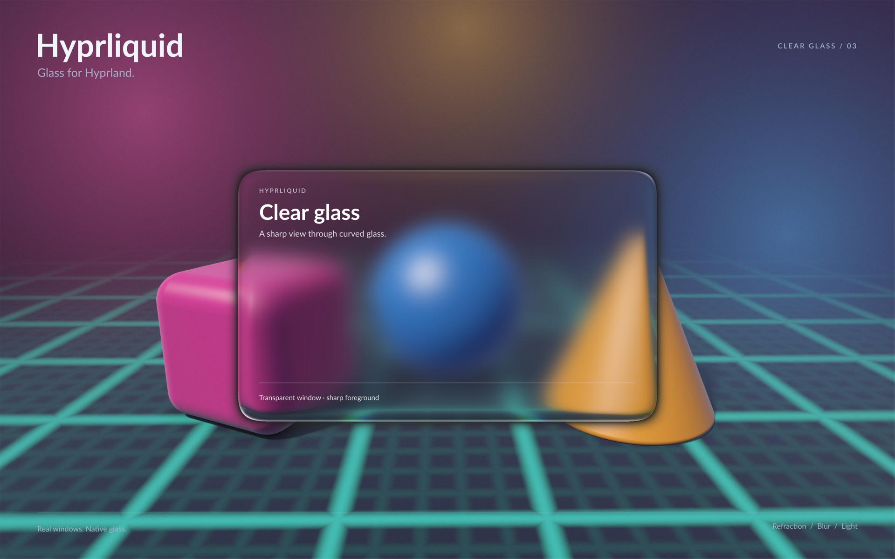
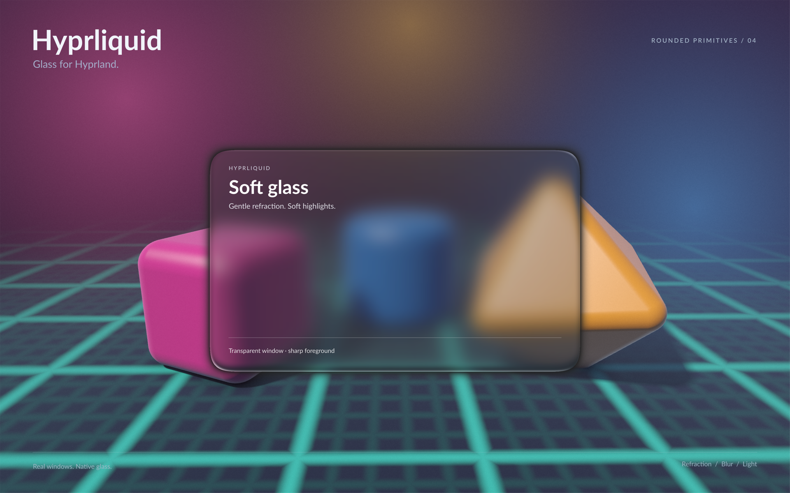
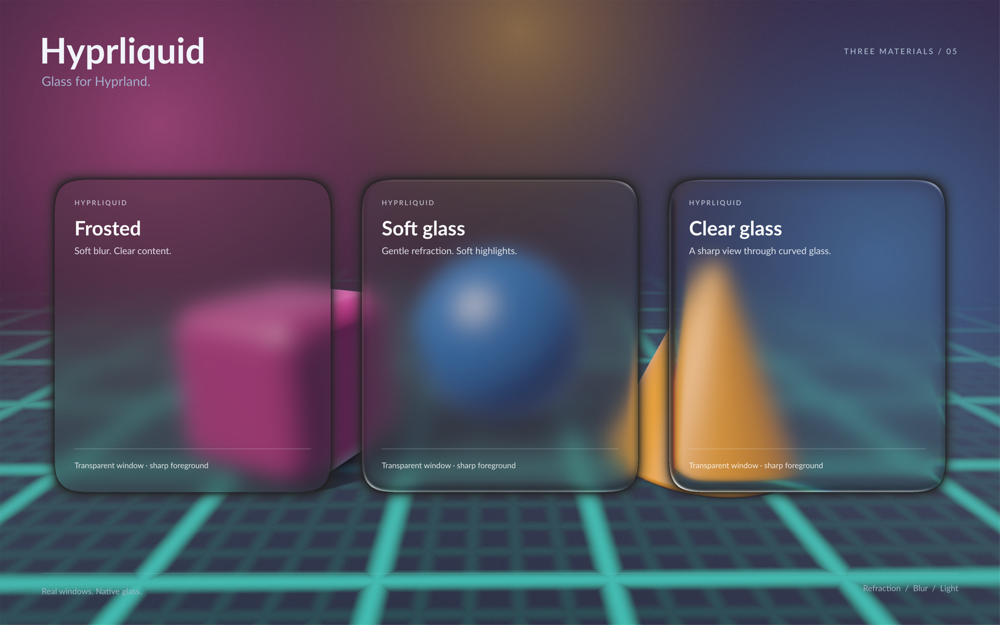
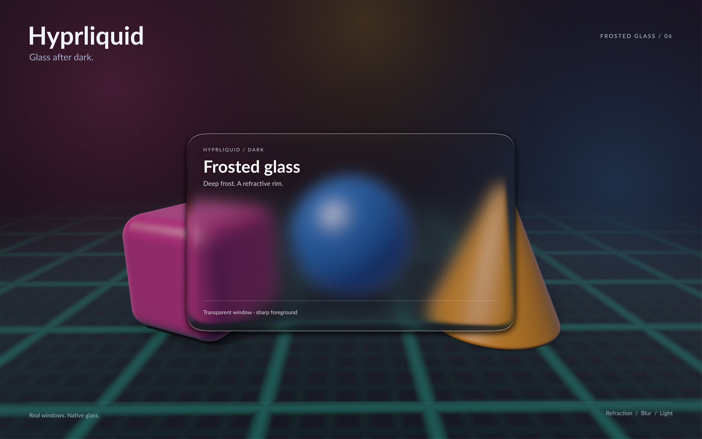
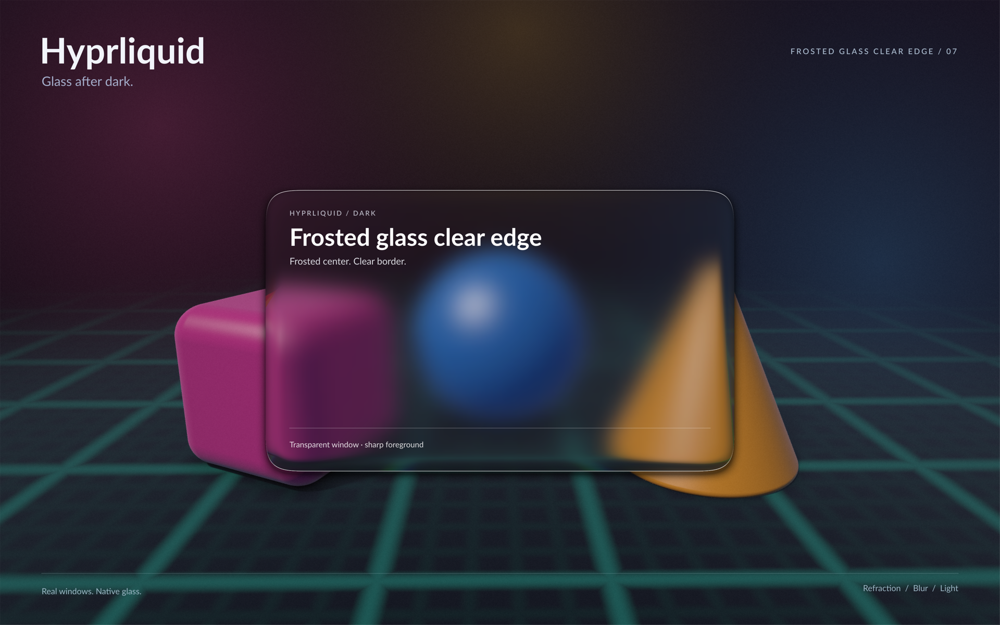
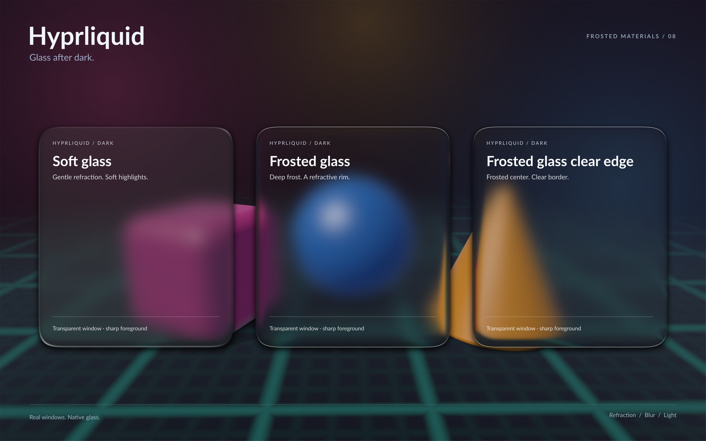
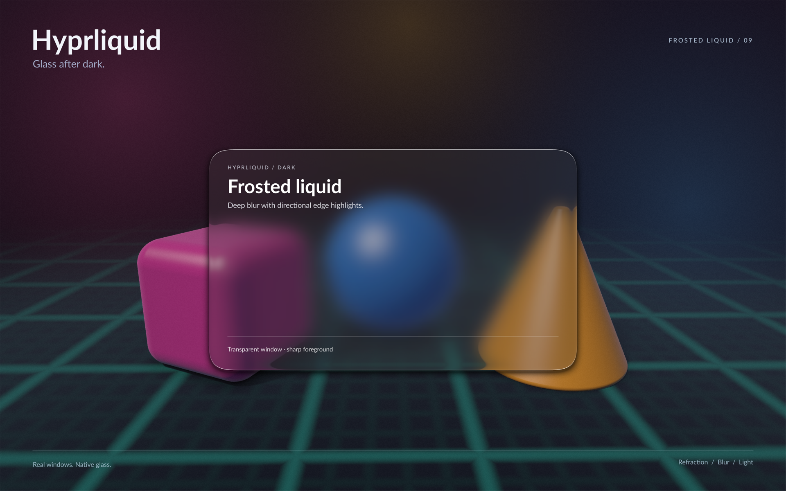
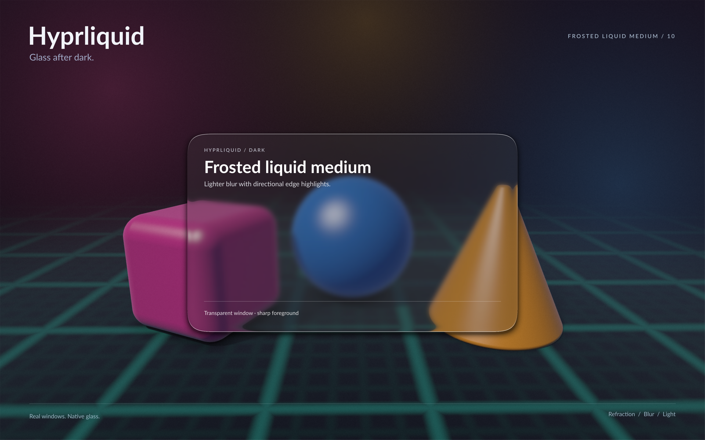

# Hyprliquid examples

## Soft Glass

## Frosted

## Clear Glass

## Soft Glass on the classic backdrop

## Frosted, Soft Glass, and Clear Glass

## Frosted Glass

## Frosted Glass Clear Edge

## Soft Glass, Frosted Glass, and Frosted Glass Clear Edge

## Frosted Liquid

## Frosted Liquid Medium

[Back to the README](../README.md#examples)
